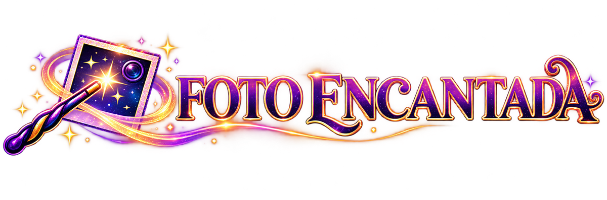

# Foto Encantada

Jogo de Quebra Cabeça: escolha uma foto, ela é cortada em peças embaralhadas e você troca as peças de lugar até montar a imagem.

## Como jogar

1. Abra o `index.html` no navegador (ou publique a pasta no GitHub Pages).
2. Toque em **Escolher minha foto** (opcional, há uma foto de exemplo) e escolha a dificuldade.
3. Toque em uma peça e depois em outra para trocá-las. Segure **Ver foto** para espiar a imagem completa.

Não precisa instalar nada: é só HTML, CSS e JavaScript.
